# Methods that were tried and dropped

This is the record of the experiments that did not make it into the harness described in [HARNESS.md](HARNESS.md)
(branch `cases4`). Most of them live on other branches. For each one: what it was, where to find it, what
happened, why we think it failed, and what was kept.

Each section separates **evidence**, numbers from runs and commit messages, from **our reading** of why it
failed. Where a branch was abandoned without a scored run, the section says so.

```bash
git show <commit>                     # the change and its message
git show <commit>:<path>              # a file as it was, e.g. git show 72b7bc4:src/raster_vector.py
git log --oneline --graph --all       # the map below
```

---

## Contents

- [Branch map](#branch-map)
- [Timeline](#timeline)
- [Summary](#summary)
- [1. s4: reading scans by image processing, with the planner driving the tools](#1-s4-reading-scans-by-image-processing-with-the-planner-driving-the-tools)
- [2. C4: reading a drawing region by region with a path agent](#2-c4-reading-a-drawing-region-by-region-with-a-path-agent)
- [3. C4: the red-team agent](#3-c4-the-red-team-agent)
- [4. Separate vision and reasoning models, two-step validation](#4-separate-vision-and-reasoning-models-two-step-validation)
- [5. The frozen frame card and the orientation checks](#5-the-frozen-frame-card-and-the-orientation-checks)
- [6. Dimension text by geometry, re-reads, reasoning effort per agent](#6-dimension-text-by-geometry-re-reads-reasoning-effort-per-agent)
- [7. Recipe plans with checkpoints, decisions by measured agreement](#7-recipe-plans-with-checkpoints-decisions-by-measured-agreement)
- [8. The parts pipeline for every drawing: points, edges, parts](#8-the-parts-pipeline-for-every-drawing-points-edges-parts)
- [9. The model switch back and forth: Haiku 5.5 and GPT-6 Luna](#9-the-model-switch-back-and-forth-haiku-55-and-gpt-6-luna)
- [10. The first web interface](#10-the-first-web-interface)
- [11. Dropped inside the current branch's own history](#11-dropped-inside-the-current-branchs-own-history)
- [12. scan-improvements: what did not work there](#12-scan-improvements-what-did-not-work-there)
- [Lessons](#lessons)

---

## Branch map

Crossed commits (✕) are the dropped methods. The trunk is `cases4`, the branch the harness runs on.

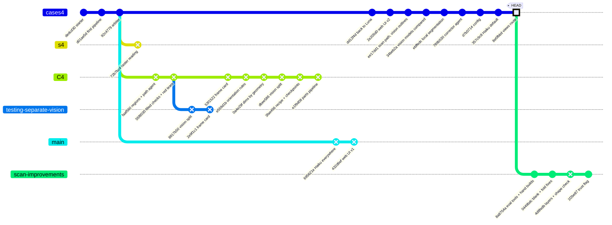

Branches not drawn: `case4-solve` and `eval` point at the starter commit and hold nothing. `vectors_test` and
`vectors_ui` are ancestors of `cases4`.

## Timeline

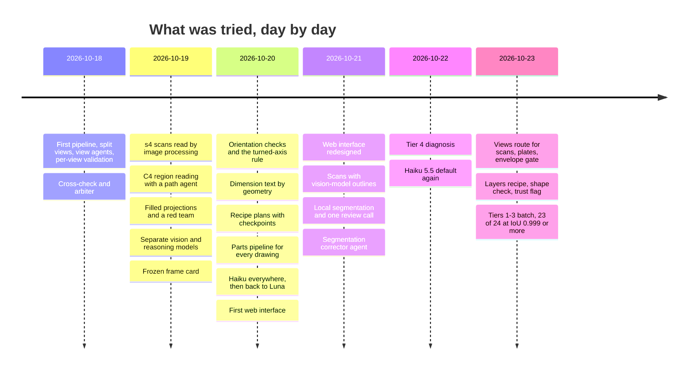

## Summary

| # | Method | Where | Aimed at | Outcome | Evidence | Kept from it |
|---|---|---|---|---|---|---|
| 1 | Scans read by image processing; the planner drives `scan_view`, `set_dimension_values`, `trace_outline`, corner check | `s4` `72b7bc4` | Tier 4 | Dropped | Ported to C4: tier 4/01 and 4/02 "still not solved" | `raster_lines.py`, `fold_sheet`, sheet-metal ops |
| 2 | One path agent per filled region | `C4` `faaf560` | Tier 4 | Dropped | "works only partially" | `regions.py` |
| 3 | Red-team agent on the kept model | `C4` `55f8030` | Trust | Dropped | Advisory only, never wired into decisions | none |
| 4 | Vision model + reasoning model, two-step validation | `C4` `dbee586`, `testing-separate-vision` `8817b50` | Cost, tier 4 | Reverted | Removed in `3fae456` and `e1f9d08` | Per-role model settings on scans |
| 5 | Frozen frame card, orientation tests, turned-axis rule | `C4` `53f1522`, `e559d1b` | Orientation errors | Dropped | Tier 4/02 at IoU 0.98 judged failing; corrections degraded rounds | Envelope gate (sorted sizes) |
| 6 | Dimension labels by geometry, re-reads, reasoning per agent | `C4` `0a4e29f` | Scan dimensions | Dropped | No scored run | none |
| 7 | Recipe plan, build checkpoints, rounds kept by measured agreement | `C4` `3fae456` | Corrections | Dropped | No scored run; replaced the same day | Keep-best-round (already on trunk) |
| 8 | Parts pipeline for every drawing (points, edges, parts, matcher) | `C4` `e1f9d08` | All tiers | Dropped for vectors; replaced for scans | Only Opus and GPT-6 Sol got the tabs right; IoU 0.18 | `part_views.find_views`, group brief |
| 9 | Haiku everywhere, then Luna, then Haiku | `main` `695621e`, `dd12f4d`, `357c9c8` | Accuracy, cost | Reversed twice | One case decided each switch | Haiku default, model picked per job |
| 10 | First web UI on daisyUI | `main` `432d6ef` | Product | Superseded | Redesigned in `2e205d0` | Job model, live steps |
| 11 | Vision outlines; one sheet-metal brief for all scans | trunk, `ee17dd1`–`357c9c8` | Tier 4 | Replaced | IoU 0.18; cases 3, 5, 6 built as flat plates | Parts route for flat patterns only |
| 12 | Layers recipe; scan projection check as trust | `scan-improvements` `4d8fedb` | Tier 4 | Off by default / not a trust signal | Case 5 at 0.25–0.41; correct part at 8–16% coverage | Trust flag, eval tools |

---

## 1. s4: reading scans by image processing, with the planner driving the tools

**Where**: branch `s4`, commit `72b7bc4` (2026-10-19). Files: `src/raster_vector.py`, `src/outline_fit.py`,
`agents/corner_check.md`, scan tools in `main.py`.

**The idea.** Turn a scanned view into the vector data that `views.py` gives for a PDF, then let the planner read
values off it. The planner had three required tools on a scan:

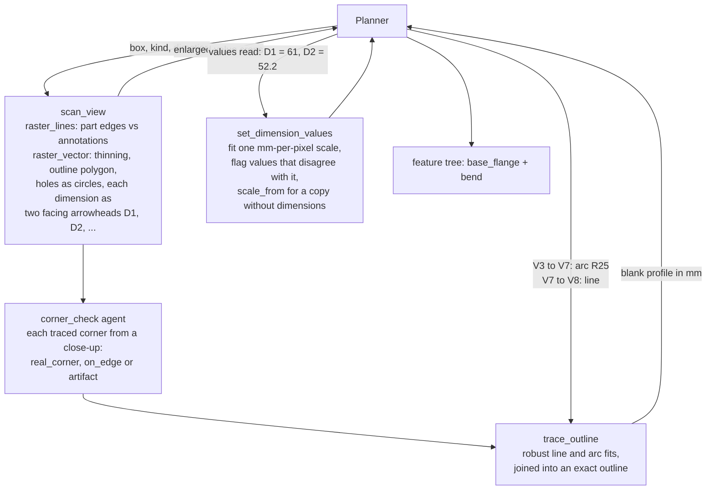

**Evidence.** The `s4` commit records no score. When its tools were ported to C4 (`faaf560`, the same day), that
commit said: "tier4/01 and tier4/02 are still not solved (bend line placement, orientation, blurry projections
for the validators)". No later branch kept `scan_view`, `set_dimension_values`, `trace_outline` or the corner
check.

**Our reading.**
- **Errors compound.** It is a long chain, and every link needs the model to judge a pixel artifact: which two
  arrowheads form one dimension, which corner is real, which stretch is an arc.
- **The planner prompt grew to cover the procedure.** It ran to several paragraphs of tool protocol (scan both
  copies of the blank, set the scale from the dimensioned one, label every span, re-read only the suspect
  values). That is a lot of protocol for a cheap model to follow.

**Kept.**
- `raster_lines.py`, which separates part edges from annotations by the darkness of a stroke's core. The scan
  validation (`raster_check.py`) still uses it.
- `sheet_metal.fold_sheet`, the deterministic fold that the parts route relies on today.
- The `base_flange` / `bend` operations in the schema.

---

## 2. C4: reading a drawing region by region with a path agent

**Where**: branch `C4`, commit `faaf560` (2026-10-19). Files: `src/regions.py`, `agents/path.md`, `paths.py`.

**The idea.** Fill every closed region of every view (P1, P2, ...) and send each region to its own agent call. The
call sees the whole sheet, the view coloured by region, and the region close up. It returns the region's role
(face, panel, hole, background, annotation), its dimensions, its edges, and how to create it.

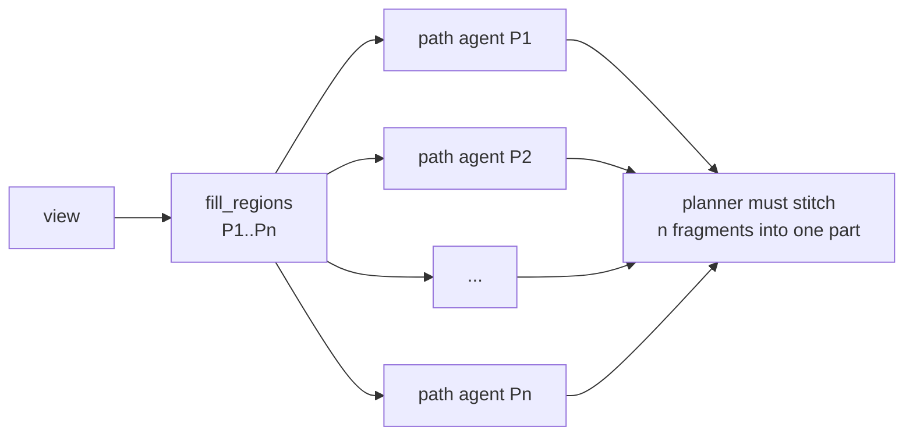

**Evidence.**
- The commit message itself: "Work in progress: this works only partially. tier4/01 and tier4/02 are still not
  solved".
- The next commit (`55f8030`) had to add "regions boxed in by dimension lines skipped as background". Filling
  every enclosed area also fills the paper between dimension lines.

**Our reading.**
- Calls grow with the number of regions, not the number of views.
- Each call sees a fragment, and the planner then has to put the fragments back together.

**Kept.** `regions.py` (`fill_regions`, `view_crops`) is the first stage of today's local segmentation
(`src/local_parts.py`).

---

## 3. C4: the red-team agent

**Where**: branch `C4`, commit `55f8030`. File: `agents/red_team.md`.

**The idea.** After the run, an agent argues that the kept model is wrong. It gets filled images of drawing and
model in every view, and the tree, and lists the strongest objections. It looks for a mirrored part, a turned
part, a missing feature or a wrong bend.

**Evidence.**
- It was "advisory" from the start: it fed no decision.
- In `e559d1b` it gained "unsupported objections are marked", a sign that it raised objections the checks did
  not back.
- It is absent from every later branch.

**Our reading.** An agent asked to find faults finds some whether or not they exist. Without a measurement
behind it, its output cannot gate anything. The harness kept the opposite rule: an issue counts only as much as
the measurement behind it (`weigh_by_evidence`, `screen_orientation_issues`).

---

## 4. Separate vision and reasoning models, two-step validation

**Where**: `C4` commit `dbee586` and `testing-separate-vision` commit `8817b50` (the same change on two bases),
plus `src/vision_models.py` (`0a4e29f`).

**The idea.**
- **Two models.** Agents that look at images (view analyses, path agent, corner check) declare `role: vision`
  and run on a cheap vision model. The candidates were Qwen3-VL, GLM-4.6V, Nemotron 3.5 VL, Ling 3.0 Flash VL and
  Gemini 3.1 Flash Lite, at $0.06–$0.30 per million input tokens. Everything else runs on the reasoning model.
- **Two-step validation.** A `validation/look` agent lists the visual differences without seeing the feature
  tree. The validator then judges from the numbers, the tree and that list, without images.

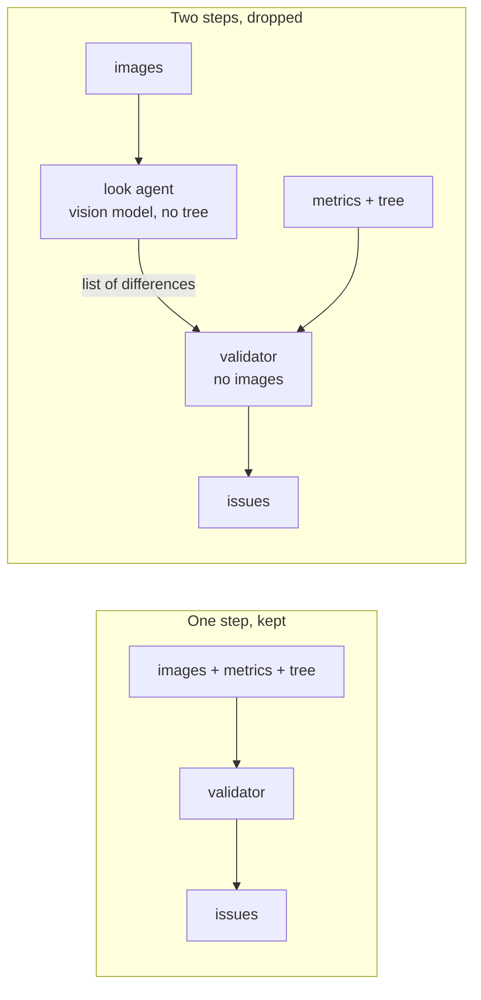

**Evidence.**
- Reverted in two steps. `3fae456` says "one model (Claude Haiku 5.5) for looking and reasoning; two-step
  validation off". `e1f9d08` says "the separate vision model and the split validation step are removed".
- No run comparing the two set-ups was recorded.

**Our reading.**
- The looker does not know which differences matter, because it has no tree.
- The judge cannot check the looker, because it has no images.
- A cheap model that handles both images and reasoning (Haiku 5.5) made the split unnecessary.

**Kept.** Scans can still set the vision, reasoning and build models separately (`D2C_VISION_MODEL`,
`D2C_SCAN_REASON_MODEL`, `D2C_SCAN_BUILD_MODEL`). All three default to Haiku 5.5.

---

## 5. The frozen frame card and the orientation checks

**Where**:
- `C4` commit `53f1522` (and `2e9f1c1` on `testing-separate-vision`): the frame card;
- `C4` commit `e559d1b`: the orientation checks and the turned-axis rule.

**The idea.** A wrong first guess at the part's orientation spoils every later step, so the planner fills in a
**frame card** before the first feature, and the card is frozen for the run. The card records:
- the part family;
- the resting face at z = 0;
- the origin, placed where the drawing measures from;
- X and Y taken from the front view;
- a turned part's axis along Z;
- the expected bounding box.

The harness then enforced the card and checked against it:
- After each build, the model is translated to the card's origin and its size along X, Y and Z is checked
  against the card.
- Scanned views are compared from the card's camera.
- A joint test tries 24 rotations and judges them on the isometrics.
- A robust orientation result becomes a whole-part plan issue.
- A turned axis may leave Z only if an isometric shows the part lying on its side.

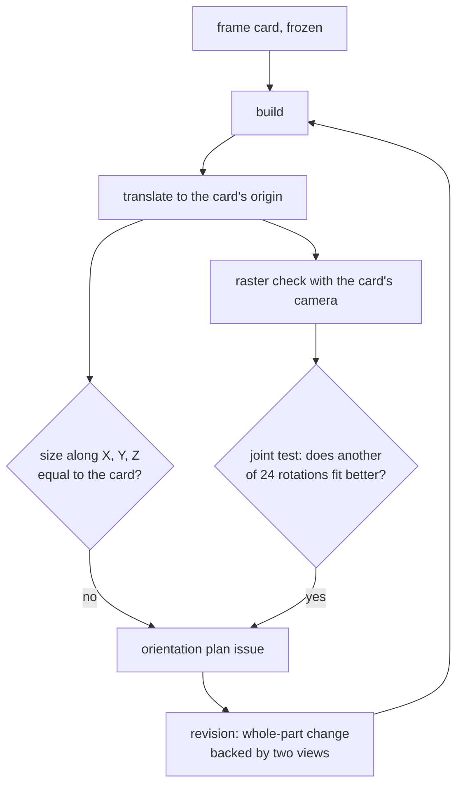

**Evidence** (`e559d1b`'s own message): "Tier 4 cases are still not solved. Measured against the references,
tier4/02 reaches IoU 0.98 but the harness still judges it failing (false high issues), corrections degrade later
rounds, and tier4/01, 04, 05, 06 have remaining shape errors."

**Our reading.**
- **The checker was wrong more often than the part.** Every new rule is one more way to flag a correct part. A
  false high issue starts a correction round, and a correction applied to a correct part makes it worse.
- **Most of the card had to be true before the checks could work.** On a scan, the camera and scale the card
  relies on are themselves guesses.

**Kept.**
- `cases4`'s frame rule is the short version: Z up, resting face at Z = 0, a turned part's axis along Z.
- The expected bounding box came back as the views route's **envelope gate**. It compares sorted sizes, so an
  axis mix-up alone does not raise an issue, and only a gross error (a part built flat, a wall left out) does.

---

## 6. Dimension text by geometry, re-reads, reasoning effort per agent

**Where**: `C4` commit `0a4e29f` (2026-10-20).

**The idea.**
- **Labels by geometry.** Each scanned dimension gets the label that sits beside its own line, between its arrows,
  running its way. All dimensions are assigned at once, so a stacked neighbour's label is not taken.
- **Re-reads.** Values that disagree with the fitted scale are shown again, wide, with the line in red.
- **Reasoning effort per agent** (off, low, medium or high) is sent to OpenRouter. A reply that spent its whole
  budget on hidden reasoning is asked again without reasoning.
- The same commit benchmarked vision models, and Claude Haiku was "skipped for now (Luna for all agents)".

**Evidence.** No scored run. All of it depended on `s4`'s `scan_view` stack (§1) and went away with it.

**Kept.** Nothing directly. The views route on `cases4` reads dimensions differently: one call per view lists the
values by direction (`scan_views.transcribe`), and the views' axes come from the values they share. It never pairs
labels with lines.

---

## 7. Recipe plans with checkpoints, decisions by measured agreement

**Where**: `C4` commit `3fae456` (2026-10-20).

**The idea.**
- **A recipe.** The planner writes the part as a workshop recipe: the stock, then each operation in order, with
  its source on the drawing, the **expected size of the part after it**, and what to check.
- **Checkpoints.** The builder calls `checkpoint(step, part)` after each step. The harness turns the first step
  whose size is off into an issue about that step, before later steps can hide it.
- **Rounds judged by measured agreement.** A round is kept or stopped by how well its trusted views agree with
  the drawing. A correction that loses agreement is undone, and the loop stops there.

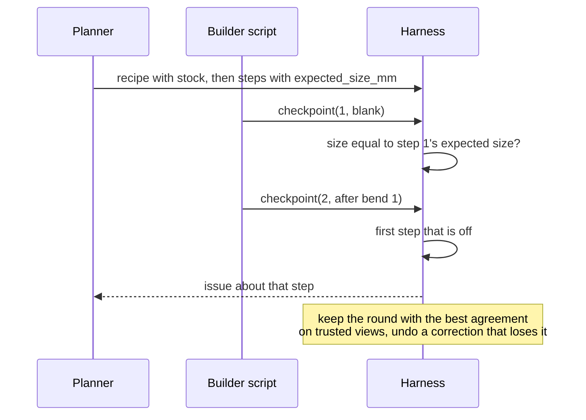

**Evidence.** No scored run was recorded. The approach was replaced the same afternoon by the parts pipeline
(`e1f9d08`).

**Our reading.**
- The expected size after each step is itself a planner guess, so a wrong recipe checks itself.
- "Measured agreement" only helps if the measurement is right. On scans it is not: a correct part scores about as
  low as a wrong one (§12).

**Kept.** The trunk already had the simpler form: every round's model is archived and the best one is restored
(`keep_best_round`), ranked by high issues first and coverage second.

---

## 8. The parts pipeline for every drawing: points, edges, parts

**Where**: `C4` commit `e1f9d08` (2026-10-20). Files: `src/part_views.py`, `src/agent/matcher.py`, `src/llm.py`,
`src/score_step.py`.

**The idea.** Read **every** drawing, vector PDFs included, with a vision model:
1. find the views;
2. for each view, three calls, each seeing the previous answer drawn on the view:
   - points where the edges meet;
   - edges joining the points;
   - parts as loops of points;
3. a matcher agent groups the parts that are the same physical part across views. Code checks its answer (every
   label once, no unknown label, no view twice in a group) and sends errors back, up to 3 rounds;
4. the planner plans from the groups, with sizes from the measuring tools of §1.

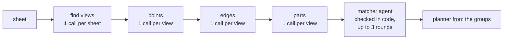

**Evidence.**
- The vector tiers never went through it on the trunk: `cases4` kept `split.py` and the view agents.
- On scans, the trunk moved to **direct** outlines by Claude Opus 5.5 (`ee17dd1`): tier 4/01 folded into one solid
  of about the right size, **IoU 0.18**.
- `34beb2a` compared vision models on the same case, on whether the end tabs were matched correctly:

| Vision model | End tabs matched | Cost of the read |
|---|---|---|
| Claude Opus 5.5 | yes | $0.34 |
| GPT-6 Sol | yes | $0.23 |
| Gemini 3.8 Flash | yes, but no parts on one flat pattern | — |
| GPT-6 Luna Pro | swapped | — |
| Claude Sonnet 5.5 | swapped | — |

- Local segmentation replaced it (`ebffedc`). With Haiku for every call on tier 4/01, it got all 11 of 11 groups
  right and built one connected solid, in 504 s for $0.077, at **IoU 0.29**.

**Our reading.**
- **Vision models place points and trace outlines poorly.** Only the most expensive ones got even the topology
  right on a simple sheet-metal part.
- **The LLM calls were not where the precision came from.** Pixels give exact geometry for free, and sizes have
  to come from the printed dimensions anyway, so the model's job shrank to what it is good at: one review of
  the groups.

**Kept.**
- `part_views.find_views`, one call to box the views, is still the first step on scans.
- The matched-groups brief for the planner is still the parts route's input.
- `PARTS_METHOD = "direct"` and `D2C_SCAN_PARTS=llm` remain as fallbacks.

---

## 9. The model switch back and forth: Haiku 5.5 and GPT-6 Luna

**Where**:
- `main` commit `695621e`: Haiku for every agent;
- `dd12f4d`: back to Luna;
- `357c9c8`: Haiku default again.

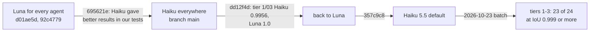

**Evidence.** The switch back to Luna rested on **one case**. On tier 1/03 (a smooth pulley), Haiku reached IoU
0.9956: it modelled the groove between the end lands only at Ø8, 0.0625 deep, instead of Ø6 to Ø8, 0.125 deep.
Luna had matched the reference exactly. In the 2026-10-23 batch, Haiku's **first** build of tier 1/03 scored
0.996, with an error in the same place: the end lands were one flat ring from Ø6 to Ø9, with no step at the drawn
Ø8. The validator of the unlabelled end view reported it as a high-severity plan issue ("the drawn Ø8 circle is absent from the
model"), and the **correction round fixed it to 1.000**.

**Our reading.** The comparison scored the first build of one case, while the harness is a loop. With the full
loop, on all 24 cases, Haiku is exact or nearly so on every vector drawing, at about $0.04 a part. Model
decisions need the whole evaluation, run with the whole loop.

---

## 10. The first web interface

**Where**: `main` commit `432d6ef` (daisyUI, Tailwind, three.js).

**What happened.** It was superseded within hours by the redesign on `vectors_ui` (`2e205d0`). That version is
an "inspection sheet" with a jobs table, a title block, steps with time and cost, the drawing, the 3D model and
the projections. It uses plain CSS and locally served fonts, and daisyUI and Tailwind were removed.

**Kept.** The job model: one process per job, `runs/ui/<job>/`, live steps built from `trace.jsonl`.

---

## 11. Dropped inside the current branch's own history

These were on the `cases4` line itself and were replaced there. They belong in this document because they failed
in the same way as the branches above.

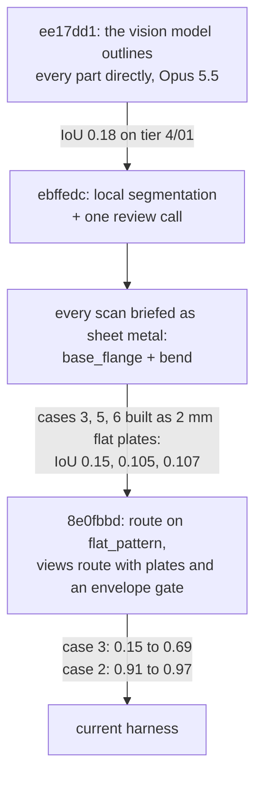

- **One sheet-metal brief for every scan** (`ebffedc` to `357c9c8`).
  - What went wrong:
    - `PARTS_BRIEF` told every scan to build a `base_flange` and bends;
    - the local segmentation labels every region as a panel, bend or hole, even on a turned or machined part;
    - `unsupported` cost the planner nothing, while every number needed evidence.
  - The result, diagnosed on 2026-10-22:
    - cases 3, 5 and 6 came out as 2 mm flat plates;
    - case 4 swapped its bore and body (Ø70/Ø90 instead of Ø62/Ø70);
    - case 7 folded the wrong panel on a wrongly snapped blank.
  - A run with the stronger GPT-6 Luna Pro on case 3 also built a flat rectangle, so the cause was the harness,
    not the model's strength.
- **Blank snapping to any flat-looking view.** `flat_blank` took any non-isometric view with panels. On case 7
  that was the bottom view of the formed part. It was fixed on `scan-improvements` (`0449bdc`) by taking only
  views labelled `flat_pattern`.

---

## 12. scan-improvements: what did not work there

**Where**: branch `scan-improvements`, 4 commits on top of `cases4` (2026-10-23), not merged. Several of its
changes are plain fixes worth merging: the evaluation tools, flat-pattern-only snapping, refusing a fold that falls
apart, and the trust flag. The three methods below did not work.

### 12.1 The layers recipe for machined parts

**The idea.** Case 5 is a machined channel housing built in Z layers:
- feet, Z 0–10: arms minus Ø100;
- floor, Z 10–12: the outline minus the Ø76 bore;
- walls, Z 12–40: the outline minus the 61.41-wide channels.

`src/layers.py` builds 2.5D regions per layer (turned rectangles, slots, fillets) and stacks them.
`D2C_SCAN_LAYERS=1` gives the planner that recipe and the builder the helper.

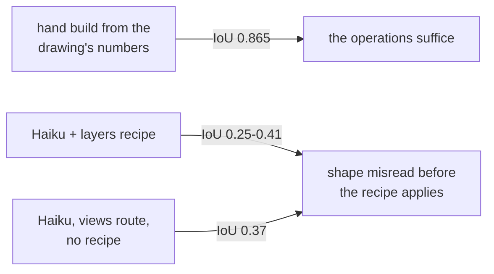

**Evidence.** Hand build 0.865; Haiku with the recipe 0.25–0.41, which is no better than without it (0.37). The
view subagents read every dimension, but the planner misread the shape: it took the lugs for a third arm and
described "three arms at 120°", then built a block. The axis solver found no shared values on case 5. The
recipe is therefore **opt-in and off by default**.

**Our reading.** A recipe helps only once the shape is understood. Here the failure comes earlier, in reading.

### 12.2 The shape check before building

`D2C_SCAN_SHAPE_CHECK=1` compares the plan's bodies with the isometric views before anything is built, and sends a
mismatch back to the planner. The commit says it is "untested against a model". It is listed here because it is
unproven, not because it failed.

### 12.3 The scan projection check as a trust signal

**The idea.** Use the projection check's coverage on scans as it is used on vector drawings: to rank rounds, to
pick the best of N runs, and to say whether a part can be trusted.

**Evidence** (tested 2026-10-23):
- On case 3, the **correct** hand-built part (IoU 0.944) scores 9 / 9 / 8% drawn-covered with the right fixed
  cameras.
- With the free camera search, which picks wrong cameras, it scores 16 / 8 / 13%. That is about the same as a
  mediocre model.
- The scales implied by the part's edges range from 5 to 14 px/mm, against a true 6.4.

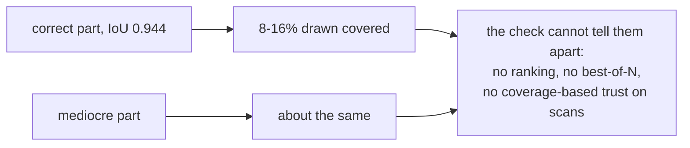

**Outcome.** A scan's result now carries a `trust` flag instead of coverage. It is `do_not_use` when no solid was
built or the part misses the envelope, and `check` otherwise, with the reasons. Correction rounds on scans still
run, though their basis is weak. They took about 60% of a scan's wall time in the 2026-10-21 runs.

---

## Lessons

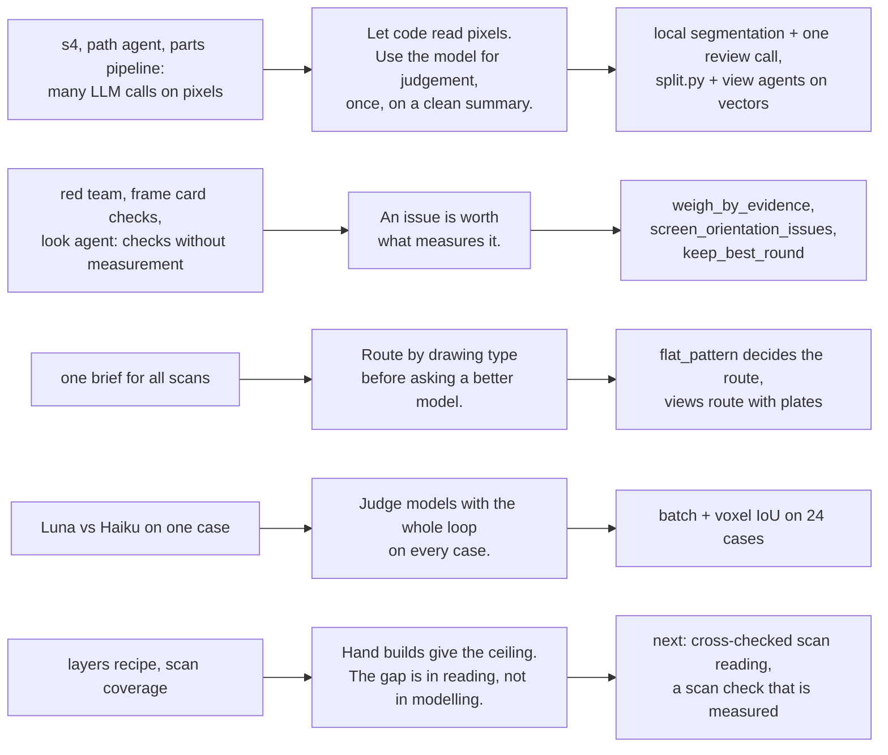

1. **Let code read pixels and the model judge.** Every method that asked a model to place points, trace outlines,
   pair arrowheads or label regions one by one (§1, §2, §8) was slow, costly and fragile. What worked was exact
   geometry from code (vector splitting, local segmentation) and a model that reviews or reads printed values.
2. **A check that is not measured does harm.** The red team, the frame-card orientation rules and the
   unmeasured views all produced false high issues, and corrections made correct parts worse (§3, §5). The
   harness now keeps an issue's severity only when a measurement backs it.
3. **Routing beats model strength.** A stronger model built the same flat rectangle on case 3. Sending the scan to
   the right route raised it from 0.15 to 0.69 (§11).
4. **One case is not an evaluation.** The model switch flipped twice on single cases. The full loop on all 24 cases
   settled it (§9).
5. **Hand builds give the ceiling.** Case 3 (0.944) and case 5 (0.865) show that the operations are enough. What
   is left is reading scans reliably, and a scan check that is actually measured (§12).
