# Draw2CAD: the harness, end to end

This document describes the whole method that turns an engineering drawing (PDF) into a STEP part in this
repository, as it stands on branch `cases4` (commit `8e0fbbd`, plus the live 3D-model update in the web UI that
is not committed yet). Every number in it comes from the code or from the runs listed in
[§10 Evaluation](#10-evaluation). The methods that were tried and dropped are in
[FAILED_METHODS.md](FAILED_METHODS.md).

**In one paragraph.** A web server queues drawings and runs each in its own process. A process first decides
whether the PDF is a vector drawing or a scan. A vector drawing is split into views by geometry, and one
analysis agent reads each view. Rule-based checks find where the views disagree, and an arbiter agent settles each
point from the drawing. A planner agent then writes a schema-checked **feature tree** in which every number must
cite the drawing or a declared assumption. A builder agent turns the tree into a CadQuery script that runs in a
child process. The model is projected back into every view of the drawing and measured, one validation agent
per view turns the measurements into issues, and up to two correction rounds send each issue to the planner or
the builder. The best round is kept. Scans (tier 4) take a separate front end: a vision model finds the views,
then either local image processing reads a sheet-metal flat pattern, or the vector path's view agents read
cropped views whose axes come from the dimension values they share.

**Results on tiers 1–3** (24 vector drawings, Claude Haiku 5.5 for every agent, 3 jobs in parallel, run on
2026-10-23): every part built, 23 of 24 at volume IoU ≥ 0.999 against the reference and one at 0.974, for $1.09
in total ($0.037 median per part), with a median of 5 minutes per part. Scans are not at that level (§10.3).

---

## Contents

1. [Architecture at a glance](#1-architecture-at-a-glance)
2. [The product layer: jobs, concurrency, isolation](#2-the-product-layer-jobs-concurrency-isolation)
3. [The agent framework](#3-the-agent-framework)
4. [Vector path, part 1: reading the drawing](#4-vector-path-part-1-reading-the-drawing)
5. [Vector path, part 2: the feature tree](#5-vector-path-part-2-the-feature-tree)
6. [Building](#6-building)
7. [Validation](#7-validation)
8. [The correction loop](#8-the-correction-loop)
9. [Scanned drawings (tier 4)](#9-scanned-drawings-tier-4)
10. [Evaluation](#10-evaluation)
11. [Traces, run folders and results](#11-traces-run-folders-and-results)
12. [Cost and time controls](#12-cost-and-time-controls)
13. [Known limits](#13-known-limits)

---

## 1. Architecture at a glance

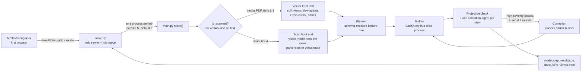

The code is organised in three layers:

| Layer | Files | What it does |
|---|---|---|
| Product | `solve.py`, `web/index.html` | Job intake, queue, worker pool, live progress, 3D viewer, projections, STEP download, questions about the part |
| Harness | `main.py` | Agent loop, tools, routing, plan → build → validate → correct, budget, traces |
| Agents | `agents/*.md`, `agents/analysis/*.md`, `agents/validation/*.md` | One Markdown file per agent: YAML settings (tools, turns, output schema) and the prompt |
| Deterministic tools | `src/*.py` | View splitting, view reading, conflicts, CAD runner, sheet-metal folding, projections, scan image processing |
| Contracts | `src/schema.py` | Pydantic models for every agent answer; the harness validates every reply against them |

The planner, builder and validators always communicate through JSON files that the schemas validate, never
through free text.

---

## 2. The product layer: jobs, concurrency, isolation

`solve.py` serves a local web app (`http://127.0.0.1:8000`). The client's methods team drops one or more PDFs,
picks a model (Claude Haiku 5.5 by default; Sonnet 5.5, Opus 5.5 or GPT-6 Luna) and starts. Each drawing becomes
a **job**.

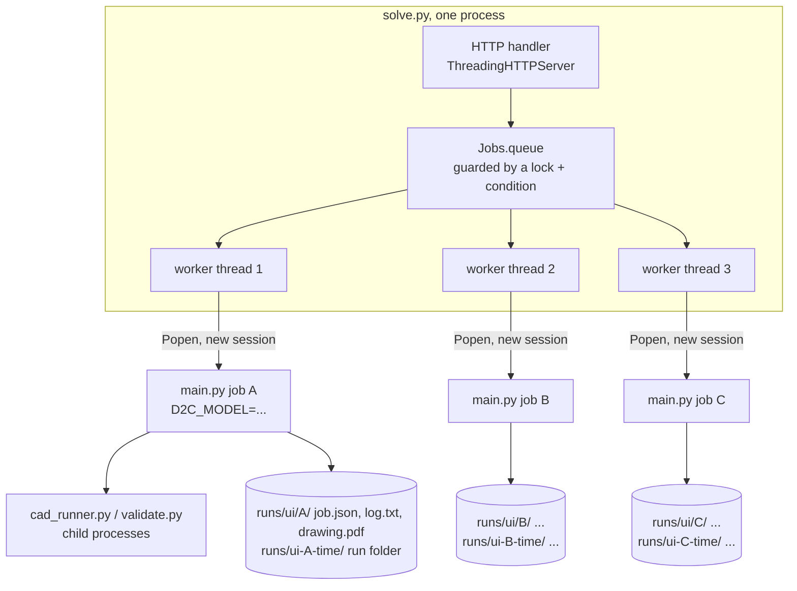

- **Isolation.** Every job runs `main.py` in its own process with its own run folder, so jobs share no memory and no
  files. Model-written CadQuery scripts and the projection checks run in further child processes, so a crash
  in OpenCascade kills only that attempt.
- **Concurrency.** `--parallel N` worker threads (default 3) take jobs from the queue. Other jobs wait.
- **Nothing is lost.** `job.json` is written atomically (temporary file + rename). On restart, queued jobs are
  queued again and a job that was running is marked `interrupted`. Its run folder is kept.
- **Stop.** A job runs in its own process group, so **Stop** sends `SIGTERM` to `main.py` and to every CAD
  process it started.
- **Live view.** The page reads the run's `trace.jsonl` to show each agent and check as a step with its time and
  cost. It shows the newest STEP as soon as the builder writes one (every build attempt, then the final model).
  When a job finishes, the page adds the projections tab (model against drawing, per view) and a question box
  about the part.

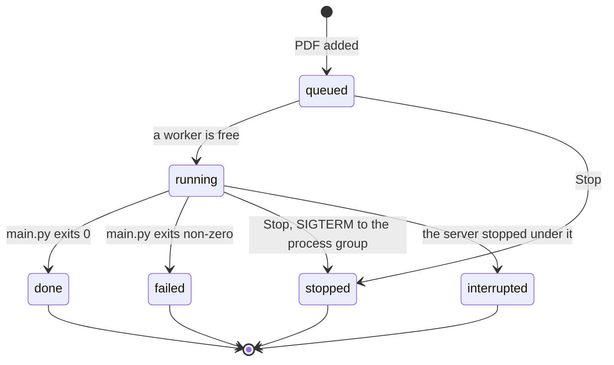

From the command line, `uv run python main.py cases/tier1/01/drawing.pdf` runs one drawing without the UI.
`--build runs/<run>` rebuilds a run's STEP from its saved plan without planning again.

---

## 3. The agent framework

### 3.1 Agents are Markdown files

Each agent is one file: YAML front matter (tools, `max_turns`, `temperature`, `output_schema`, budget), then the
prompt. `load_agent()` reads it. The harness appends the output model's JSON Schema to the system prompt, so the
model sees the exact contract it must meet.

| Agent | File | Tools | Max turns | Output schema |
|---|---|---|---|---|
| Planner (main) | `agents/main.md` | `view_drawing`, `read_drawing_text`, `split_views`, `call_subagent` | 20 | `PartPlan` (`ScanPartPlan` on the views route) |
| Front / top / side view | `agents/analysis/{front,top,side}.md` | `read_view_text`, `zoom_view` | 6 | `FrontSummary`, `TopSummary`, `SideSummary` |
| Section view | `agents/analysis/section.md` | `read_view_text`, `zoom_view` | 8 | `SectionSummary` |
| Detail view | `agents/analysis/detail.md` | `read_view_text`, `zoom_view` | 6 | `DetailSummary` |
| Isometric view | `agents/analysis/isometric.md` | `read_view_text`, `zoom_view` | 4 | `IsometricSummary` (no numbers allowed) |
| Arbiter | `agents/analysis/arbiter.md` | `view_drawing`, `read_drawing_text`, `extend_view` | 10 | `ArbiterReport` |
| Builder | `agents/builder.md` | `run_cadquery` | 12 | `BuildReport` |
| Validator, one per view type | `agents/validation/*.md` | `zoom_comparison` | 5 | `ValidationReport` |
| Segmentation corrector (scans) | `agents/corrector.md` | none (one call per view) | 1 | JSON corrections, applied by `src/corrector.py` |

Every agent runs on one model, `MODEL` (`D2C_MODEL`, default `anthropic/claude-haiku-5.5`). The YAML `model:`
lines still name GPT-6 Luna, but the harness overrides them and logs a warning. On a scan, the vision, reasoning
and build models can be set separately (§9.5).

### 3.2 Tools are typed Python functions

A tool is a plain function `fn(ctx, arg: Annotated[type, "description"], ...)`. `tool_schema()` turns its type
hints, `Annotated` descriptions and docstring into an OpenAI function schema, so the prompt, the schema and the
code cannot drift apart. A tool can return images (`ToolOutput(data, images)`). The harness sends the data as
the tool result and the images as a following user message, because tool messages carry text only.

| Tool | Used by | What it returns |
|---|---|---|
| `view_drawing` | planner, arbiter | The sheet, or a zoomed region of it, as an image |
| `read_drawing_text` | planner, arbiter | Every text span with its position (empty on scans) |
| `split_views` | planner | The views with id, type, label, scale, outline size, texts and **axes in the part frame**, plus a sheet image with the views boxed |
| `call_subagent` | planner | Runs one view agent and returns its JSON. After the last view it also returns the cross-check and the arbiter's rulings |
| `read_view_text`, `zoom_view` | view agents | Text inside the view crop. Zoomed regions |
| `extend_view` | arbiter | A region of one view **plus the same band in every view aligned with it on the sheet** (projection lines), with the text found there |
| `run_cadquery` | builder | Runs the script in a child process: `ok`, the error and failing line, or measurements (bounding box, volume, cylinders by diameter, solid count) |
| `zoom_comparison` | validators | One region of the overlay (drawing black, model red) in mm, enlarged |

### 3.3 The agent loop

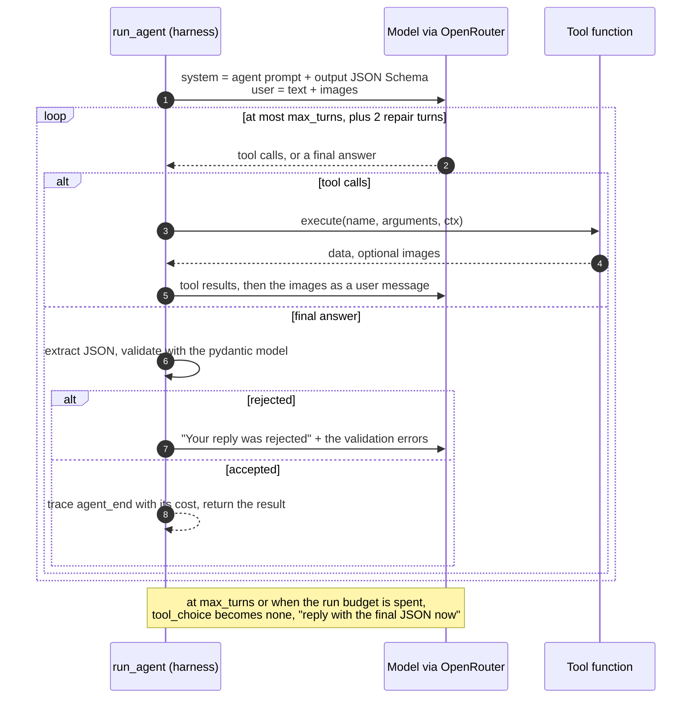

- **Validation errors are feedback.** A reply that is not JSON or breaks the schema goes back to the model with up
  to 25 precise errors (`F03.depth = 12 has no evidence with role 'depth' and no assumption`). The model gets
  two extra turns to fix it.
- **Every call is traced** (`trace.jsonl`): request id, token usage, cost, content and tool calls. Every tool
  execution is traced with its arguments, result, duration and success.
- **Cost is counted per call** from OpenRouter's `usage.cost`. Calls without a reported cost are counted
  separately and reported in `result.json`.
- **Retries.** On a scan, a call that fails with a connection error, timeout, 5xx or 429 is retried after 15, 60
  and 180 s. A vector drawing's calls are made once (the OpenAI client still retries twice).

---

## 4. Vector path, part 1: reading the drawing

The planner drives this stage through its tools. The harness adds the cross-check automatically when the last
view comes back.

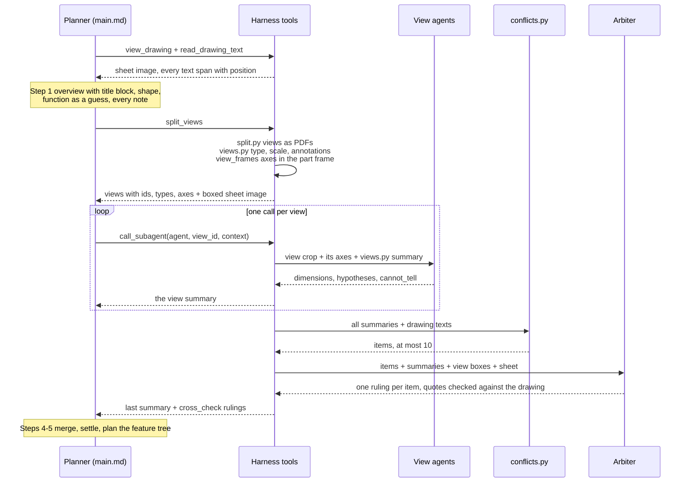

### 4.1 Splitting the sheet (deterministic)

- **`src/split.py`** groups the vector strokes of the sheet into connected components (outlines with a 6 pt gap,
  annotations with 3 pt), attaches each text to its nearest component, recognises view labels (`SECTION A-A`,
  `DETAIL B`, `TOP VIEW`, `ISOMETRIC`...), drops the title block, and saves each view as its own PDF and PNG.
- **`src/views.py`** reads each view PDF into a typed object (`OrthographicView`, `SectionView`, `DetailView`,
  `PictorialView`, ...). It parses every annotation (`Ø`, `R`, chamfers, linear values, `Nx` counts) and finds
  the scale by voting which standard scale makes drawn lengths agree with printed values. It also measures
  hatching. Every value that can be missing is wrapped in `Declared(value, source, confidence, evidence)`, so a
  value read from the drawing is never confused with a guessed one.
- **`validate.view_frames`** gives each view its **axes in the part frame** (image right, image up, viewing
  direction). It works them out from the labels, the sheet layout (first- or third-angle placement of unlabelled
  views) and the arrowheads of cutting-plane lines. These axes are passed to every agent that sees the view, and
  they override the generic "front view = X and Z" rule in the prompts.

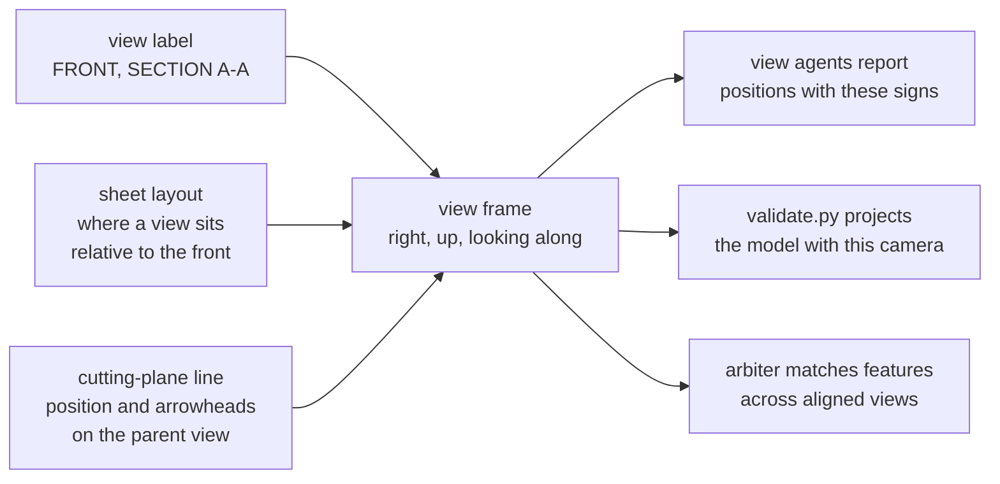

### 4.2 One analysis agent per view

Each view type has its own prompt with the reading rules for that type. Sections, for example, have rules for
hatched material and blank cavities. They also say that equal-diameter cross holes meet along 45° lines, and that
a small dimension at a centreline means a hole goes past the axis. A view agent sees **only its crop**, the text
inside it and the `views.py` summary. It reports:

- `dimensions`: each value as printed and what it measures;
- `hypotheses`: features with an operation, params, evidence quoted exactly, and a confidence (0.9+ only when a
  dimension or callout states it);
- `cannot_tell`: what this view cannot decide.

Isometric summaries may not contain numbers: the schema rejects numeric params on a pictorial view.

### 4.3 Cross-check and arbiter

A weak model rarely notices that two view summaries contradict each other. So before planning,
**`src/conflicts.py`** finds such places with five plain rules:

| Rule | Fires when |
|---|---|
| `count_mismatch` | The same kind of hole is counted differently in two views (one count from an `Nx` callout) |
| `unsupported_value` | A value in a hypothesis is not on the drawing, nor half, a sum or a difference of two drawing numbers |
| `unmeasured_feature` | A feature one view sees (often the isometric) that no view gives a size for |
| `uncertain` | A hypothesis the agent itself rates below 0.6 that carries dimensions |
| `unexplained_dimension` | A dimension on the drawing that no hypothesis in any view uses |

The **arbiter** settles each item (at most 10) from the drawing itself. Its main tool, `extend_view`, follows a
contact place along the projection lines: the same band in every view drawn beside it (same height) or above it
(same width). It rules each item `resolved`, `already_covered` or `unresolved`. The schema checks that every
quote in a `resolved` ruling is real text on the drawing. Resolved rulings override the view summaries.
Unresolved ones become assumptions.

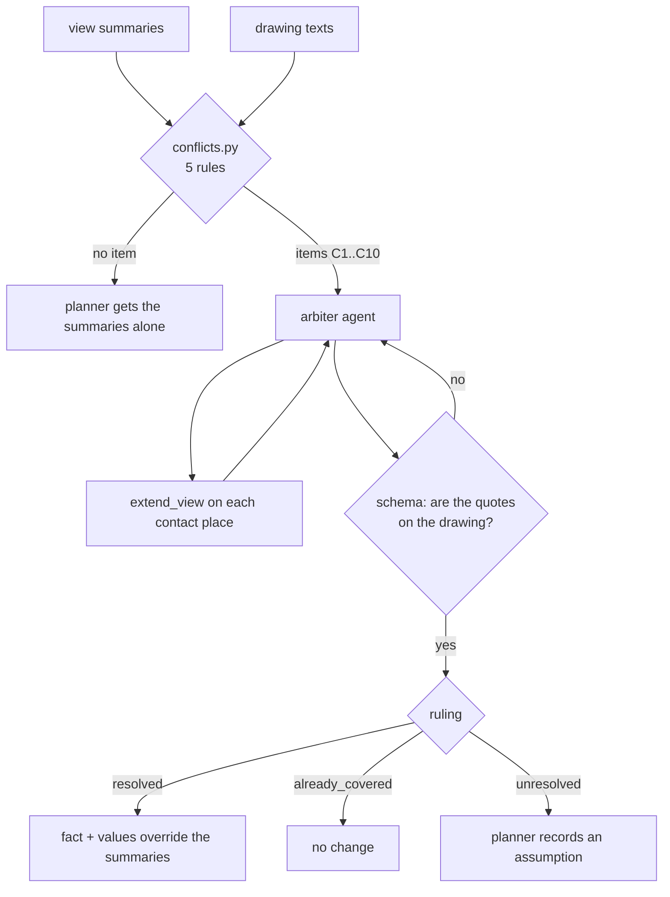

---

## 5. Vector path, part 2: the feature tree

The planner merges the summaries and rulings into one **feature tree**: the ordered list of operations a CAD
modeller would follow. It is the single source of truth for the builder and the validators.

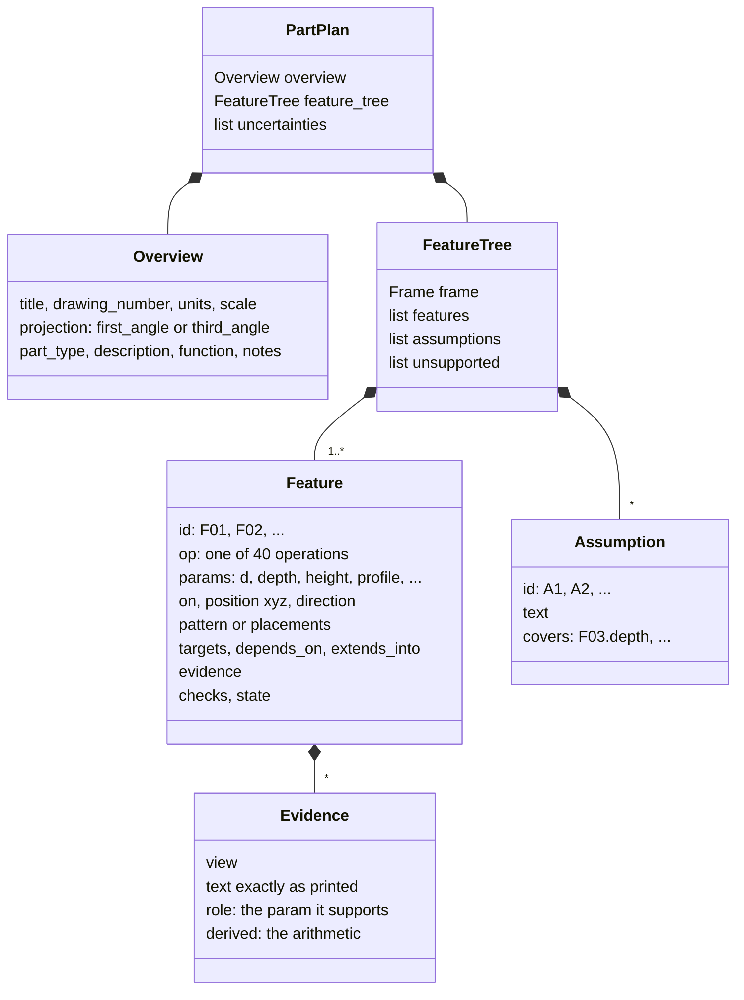

### 5.1 The operations

The planner picks each operation from a fixed list of 40 (`src/schema.py` `Op`). Its prompt maps drawing cues to
operations:

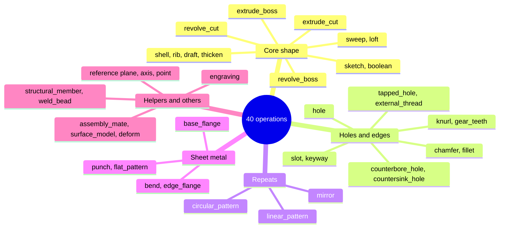

### 5.2 The evidence rule: every number has a source

The schema enforces the most important rule of the plan. A tree is rejected, and sent back with the reasons,
unless:

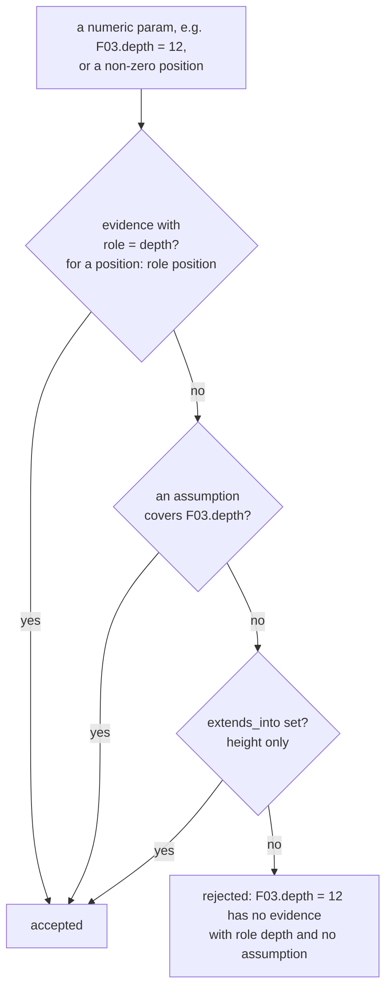

The same validator checks the rest of the tree's structure:
- ids are unique, and `depends_on` and `targets` only point at earlier features;
- every assumption covers an existing feature;
- every feature has a position;
- a profile is geometry, not a word like "rectangle";
- slots have a `long_axis`;
- a feature uses a regular `pattern` or explicit `placements`, never both.

The planner prompt adds rules that the earlier runs showed were needed:
- **Callouts are not negotiable.** An assumption may fill a gap but never narrow a callout. `THRU` means
  through every wall on the axis. This rule came from tier 2/03, where "through the flange only" survived every
  round.
- **Merging features extend into what they join.** A support under a barrel declares `extends_into: F04`, and
  the harness computes its height (`apply_extensions`): the distance along the feature's direction from its start
  to the barrel's axis. The model no longer guesses the size of a hidden edge.
- **Cross holes reach at least the axis** of the bore they open into.
- **Round outlines are circles** (`d` and `profile: "circle"`), never polygons.
- **`unsupported` is only for what no operation can express** (gear teeth, engraving). A notch or step, however
  irregular, is an `extrude_cut` with its profile as points.

The frame is fixed: Z up, the resting face at Z = 0, centred on the main axis or symmetry lines, and a turned
part's axis is Z.

### 5.3 Sheet metal

When the sheet has a flat pattern, the part is a `base_flange` (the blank outline, thickness, radius, K-factor,
and `fixed`, a point in the panel that stays flat) followed by one `bend` per bend line. Holes are placed at their
flat positions, so they fold with their panel. A sheet-metal part drawn only formed has no blank to fold, so it is
built from plates (§9.3).

---

## 6. Building

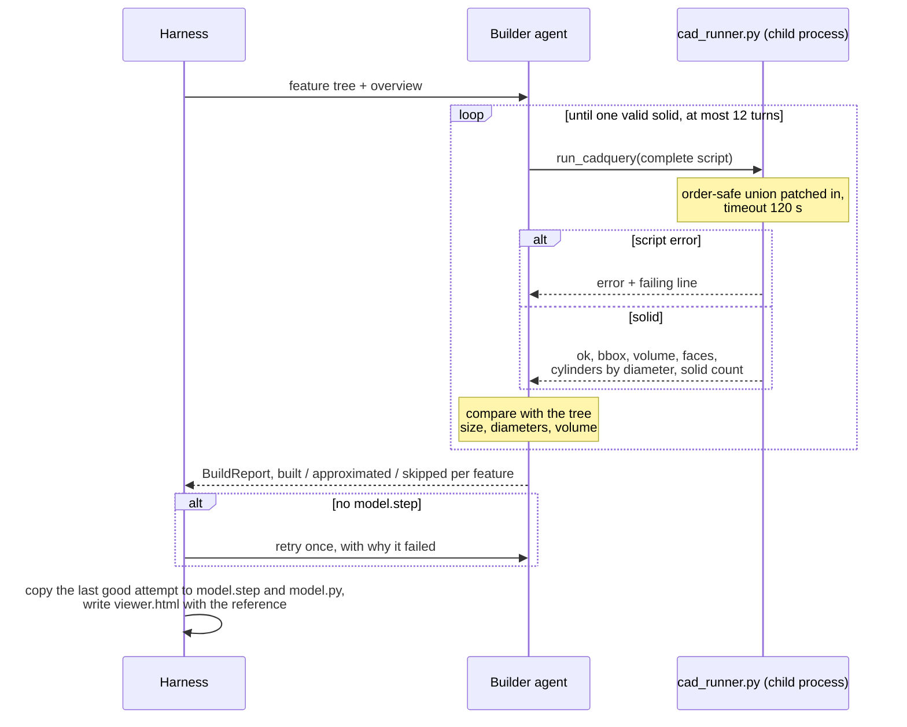

- **One complete script per call**, assigning `result`, with every param at the top (`F02_d = 6.4`) and one
  commented block per feature in tree order. Recipes in `agents/builder.md` cover each operation: explicit
  cylinder and cone cutters for holes, `slot2D` laid along the `long_axis`, revolve about Z then rotate, tap-drill
  diameters for threads, and fillets wrapped in `try/except`.
- **`src/cad_runner.py`** runs the script, exports STEP and measures the solid. It also patches
  `Workplane.union` to be **order-safe**: CadQuery silently drops a part unioned into a body that is already in
  several pieces. The patched union fuses all pieces in one operation, so a bridging part joins everything it
  touches.
- **Sheet metal is folded by code, never by hand.** `src/sheet_metal.fold_sheet(profile, thickness, k_factor,
  radius, fixed, bends, holes)` splits the blank at each bend zone, centred on the bend line and
  `radians(angle) × (radius + k × thickness)` long. It then folds every panel through the bends between it and
  the fixed panel, so folds chain whatever their order, and it cuts the holes in the flat blank first.

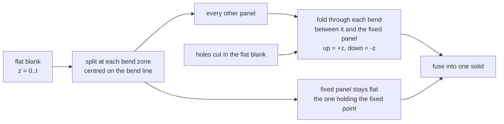

- **Each attempt is kept** (`build/attempt_NN.py`, `.step`, `.json`). The UI shows a new model after every
  successful attempt.

---

## 7. Validation

Validation compares the built part with the drawing in each view. A measurement program does the comparing.
Agents only interpret its results, and two filters weigh their issues by what backs them.

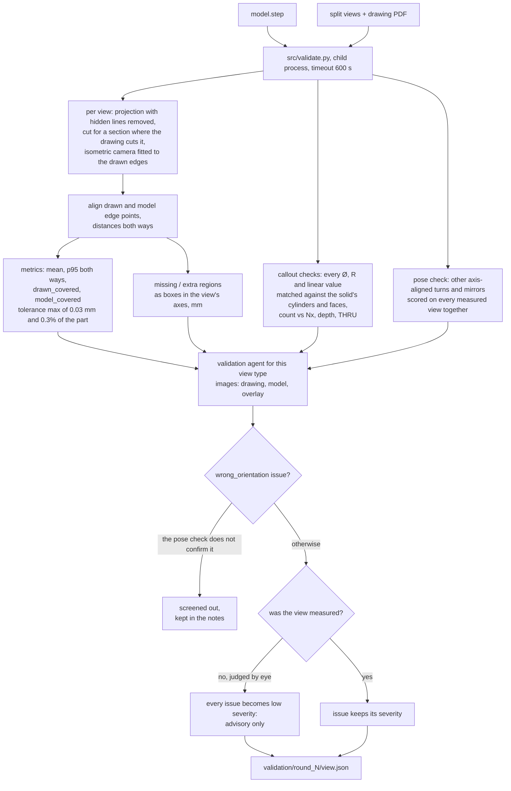

What each validator reports:
- `verdict`: pass, minor or fail; the schema forbids "pass" with a high issue and "fail" without one;
- `matches`: what the view confirms, so a correction does not break it;
- `issues`: each with `kind` (missing, extra, wrong_size, wrong_position, wrong_orientation), what the drawing
  and the model show, the feature id, a concrete `fix` (`F02.height: 3 -> 40`), the `severity`, and the
  **`owner`**:
  - `plan` when the tree itself disagrees with the drawing, including an assumption that narrows a callout;
  - `build` when the tree is right and the script does not follow it.

The two screening filters exist because the validators produced false alarms that corrections then acted on:
- **Orientation is decided by all views together.** One view's left and right cannot prove a mirror.
- **Unmeasured views are advisory.** A small pictorial view judged by eye cannot trigger a correction round on its
  own.

---

## 8. The correction loop

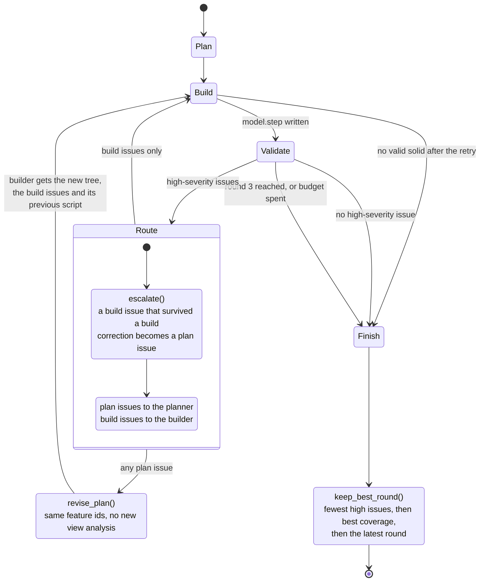

- **At most two correction rounds** (`MAX_CORRECTIONS = 2`), so at most three builds.
- **Revisions are local.**
  - The planner gets the issues, the pose check, its current plan, the view summaries and the rulings. It must
    keep every feature id and change only what the issues point to. It may disagree with an issue after
    re-reading the drawing and record why.
  - The builder starts from its previous script and changes nothing that was confirmed.
- **A correction can make things worse**, so every round's model is archived in `validation/round_N/`.
  `keep_best_round` restores the best one by `(high issues, −drawn_covered, −round)`.
- **Feature states** are updated after each round: `built` → `passing` or `failing` (named by a high issue).

---

## 9. Scanned drawings (tier 4)

A scan has no vector geometry and no text layer, so neither `split.py` nor `read_drawing_text` works. `main.py`
detects it (`is_scanned`: no page has drawings or words) and routes it through its own front end. Planning,
building, validation and correction then reuse the vector machinery.

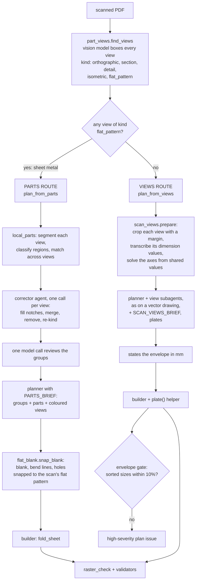

### 9.1 Finding the views

One vision-model call per sheet returns a box per view with its kind (`part_views.find_views`). The kind decides
the route. Only a sheet with a `flat_pattern` goes to the parts route. On the tier 4 cases, only cases 1 and 7
have one.

### 9.2 Parts route (sheet metal with a flat pattern)

The parts route reads a flat pattern locally, without asking a model to trace outlines:

1. **`src/local_parts.py`, image processing only.**
   - `regions.fill_regions` fills every closed region of a view.
   - Each region is classified as face, hole, text, bend or other. Holes on flat views are circles found on the
     ink, because centre lines cut a drawn hole into quarters.
   - A flat view cut into strips by dimension lines gets its panels from a cleaner copy, registered onto its ink
     (8 rotations or mirrors, scale, shift).
   - Faces form a neighbour graph. The reference flat view is matched to every other view by the mapping that
     best keeps hole counts, hole size order and neighbours. Holes and bends follow their faces.
2. **`src/corrector.py` + `agents/corrector.md`**, one call per view. The agent sees the coloured view, the plain
   view and per-part pixel facts: area, inscribed width, the notch area left by a closing with a disc, and where
   the notches are. It answers with operations (`fill_notches`, `merge`, `remove`, `kind`), which the code applies
   exactly. The agent never draws geometry.
3. **`src/local_llm_match.py`**: one call reviews the groups against the images. If the reply cannot be read, the
   local groups are kept.
4. **Planner** with `PARTS_BRIEF`: the groups, every part outline in PDF points, and every view coloured by group.
   It has only `view_drawing` and `read_drawing_text`. Sizes still come from the printed dimensions.
5. **`src/flat_blank.snap_blank`** replaces the planned blank with the scan's own flat pattern, because the
   planner gets the overall size right but often the shape wrong:
   - the blank is the union of the flat view's panels;
   - it is fitted onto the plan, on the holes when there are any: the scale from the diameters, the turn and
     shift from the planned centres;
   - each bend line and hole centre is then snapped to the nearest local one.

   The planner's operations, bend directions, angles, radii, hole sizes and thickness are kept.
6. **Builder** folds with `fold_sheet`.

### 9.3 Views route (no flat pattern)

Most scans are machined or welded parts drawn in orthographic views. They go through the **vector path's planner
and view agents**, on views that `src/scan_views.py` prepares:

1. Each view is cropped into its own PDF with a 20 pt margin, so dimension text at its edge stays in the crop.
   A cut "5" was once read as "6".
2. One call per orthographic view or section transcribes its linear dimension values, grouped by the direction of
   their dimension line (horizontal or vertical in the image).
3. **Axes from shared values.** Two image axes that print the same values (at least 2 shared values ≥ 2 mm, within
   0.15 mm) measure the same part axis. The view linked to the most others is the plan (right = X, up = Y). A view
   linked to a placed one takes that axis, and Z on its other image axis. This catches a view drawn turned on the
   sheet, which the vision model's names miss.

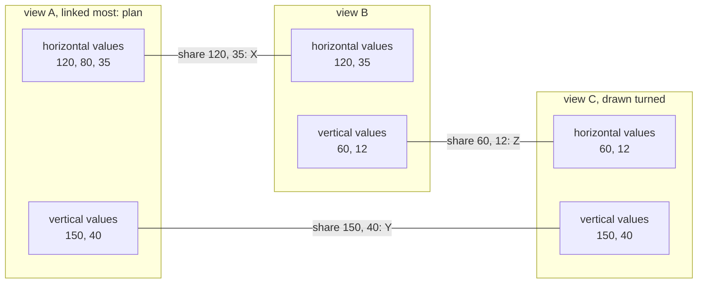

*(Illustrative values. View C prints the Y values vertically and the Z values horizontally, so it was drawn turned
90°.)*

4. `split_views` hands these crops to the planner with their axes, and the planner calls the view subagents as
   on a vector drawing. The planner prompt gets `SCAN_VIEWS_BRIEF`:
   - **thin-walled parts are plates**: find each plate as a strip of constant width in two views and full size in
     the third; read the thickness from dimensions, never assume it; one `extrude_boss` per plate in the axes of
     the view that shows it at full size;
   - never put a wall in `unsupported`;
   - state the part's **envelope** (`overview.envelope_mm`, schema `ScanPartPlan`).
5. The builder gets `src/plates.plate(profile, direction, start, thickness)`. Without it, CadQuery's "XZ" workplane
   extrudes toward −Y, which is an easy sign error.
6. **Envelope gate.** After each build, the part's sorted bounding box is compared with the sorted envelope. Off by
   more than 10% on any size is a high-severity plan issue. A part built flat, a missing wall or a panel folded
   the wrong way fails it. A pure axis mix-up passes, because the sizes are sorted.

### 9.4 Validating a scan

`src/raster_check.py` writes the same `validation.json` as `validate.py`, so the validators and the correction
loop run unchanged on scans:
- `raster_lines.py` separates part edges from annotations by the darkness of each stroke's core;
- the camera is searched over the 6 standard directions × 4 turns on the sheet, and over 4 isometric cameras;
- the scale is measured from dimension values where possible;
- hole centres are matched to the model's cylinders as landmarks;
- the validators get filled images instead of dotted edges.

Validators are told that a scan's camera and scale were fitted, not measured, and that no callouts are checked.
See §13 for how reliable this check is.

### 9.5 Models and budget on scans

| Role | Setting | Default |
|---|---|---|
| Finds the views, transcribes dimensions | `D2C_VISION_MODEL` | Claude Haiku 5.5 |
| Planner and validators | `D2C_SCAN_REASON_MODEL` | Claude Haiku 5.5 |
| Builder | `D2C_SCAN_BUILD_MODEL` | Claude Haiku 5.5 |
| Budget (plan, build, validate) | `D2C_SCAN_MAX_COST` | $3.00, plus what the vision step cost |
| Parts reading | `D2C_SCAN_PARTS` | `local` (`llm` = the vision model outlines parts, the older method) |

---

## 10. Evaluation

### 10.1 Method

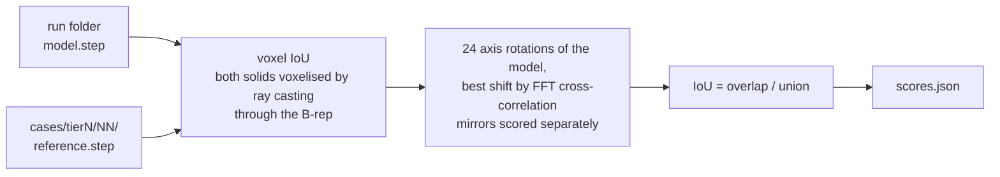

The scorer is independent of the frame each part was built in: the model is tried in all 24 axis-aligned
rotations, each registered by FFT. It lives in `tools/voxel_iou.py` and `tools/score_runs.py` on branch
`scan-improvements` (commit `8a8754a`), which is not merged into `cases4` yet. The harness's own verdicts
(`validated`, `drawn_covered`, `high_issues_left`) come from the drawing alone and never see the reference.

### 10.2 Tiers 1–3 (vector drawings)

Batch of 2026-10-23, 09:41–10:44, `runs/batch-20261023-094131/`, Claude Haiku 5.5 for every agent, three jobs at a
time.

| Case | IoU | Rounds | CAD runs | Time (s) | Cost ($) | Harness: drawn covered | Harness: high issues left |
|---|---|---|---|---|---|---|---|
| tier1/01 | 1.000 | 1 | 1 | 145 | 0.027 | 1.000 | 0 |
| tier1/02 | 1.000 | 2 | 4 | 1494 | 0.073 | 0.721 | 0 |
| tier1/03 | 1.000 | 2 | 9 | 881 | 0.086 | 0.948 | 0 |
| tier1/04 | 0.999 | 1 | 3 | 299 | 0.034 | 0.998 | 0 |
| tier1/05 | 0.999 | 1 | 1 | 204 | 0.028 | no measured view | 0 |
| tier1/06 | 1.000 | 1 | 1 | 186 | 0.025 | 1.000 | 0 |
| tier1/07 | 1.000 | 1 | 2 | 163 | 0.023 | 1.000 | 0 |
| tier1/08 | 1.000 | 1 | 1 | 234 | 0.032 | 1.000 | 0 |
| tier2/01 | 1.000 | 1 | 4 | 329 | 0.043 | 1.000 | 0 |
| tier2/02 | 1.000 | 1 | 1 | 350 | 0.054 | 1.000 | 0 |
| tier2/03 | **0.974** | 3 | 4 | 1316 | 0.116 | 0.951 | **1** |
| tier2/04 | 1.000 | 3 | 4 | 679 | 0.071 | 0.980 | 0 |
| tier2/05 | 1.000 | 2 | 2 | 601 | 0.045 | 0.993 | 0 |
| tier2/06 | 1.000 | 1 | 1 | 293 | 0.037 | 1.000 | 0 |
| tier2/07 | 1.000 | 1 | 1 | 235 | 0.026 | 1.000 | 0 |
| tier2/08 | 1.000 | 1 | 1 | 234 | 0.029 | 1.000 | 0 |
| tier3/01 | 1.000 | 1 | 1 | 434 | 0.063 | 0.992 | 0 |
| tier3/02 | 1.000 | 1 | 1 | 512 | 0.038 | 0.686 | 0 |
| tier3/03 | 1.000 | 1 | 1 | 309 | 0.039 | 1.000 | 0 |
| tier3/04 | 1.000 | 1 | 1 | 380 | 0.048 | 0.997 | 0 |
| tier3/05 | 1.000 | 1 | 1 | 297 | 0.033 | 1.000 | 0 |
| tier3/06 | 1.000 | 1 | 1 | 277 | 0.036 | 0.995 | 0 |
| tier3/07 | 0.999 | 1 | 1 | 267 | 0.034 | 1.000 | 0 |
| tier3/08 | 1.000 | 1 | 1 | 338 | 0.047 | 1.000 | 0 |
| **All 24** | 23 ≥ 0.999 | 19 in round 1 | | median 304 | **1.085 total**, median 0.037 | | |

What the table shows:
- **The trust signal that works is "high issues left".** The only imperfect part (tier 2/03, 0.974) is the only
  run that finished with a high-severity issue.
- **Coverage alone is not a trust score.** Two exact parts (IoU 1.000) report only 0.72 and 0.69 drawn-covered
  (tier 1/02, tier 3/02), so the shortfall is the check's error, not the model's. A third, tier 1/05 (IoU 0.999),
  has no measured view at all. Its only orthographic view is unlabelled, so its direction is unknown and it is not
  projected. The isometric camera could not be fitted, so that view was judged by eye.

**Did the correction rounds help?** Every round's model is archived in `validation/round_N/`, so each one can be
scored:

| Case | Round 1 | Round 2 | Round 3 | Kept by the harness |
|---|---|---|---|---|
| tier1/02 | 0.983 | **1.000** | — | round 2 |
| tier1/03 | 0.996 | **1.000** | — | round 2 |
| tier2/03 | 0.968 | **0.987** | 0.974 | round 3 |
| tier2/04 | 0.998 | not scored yet | **1.000** | round 3 |
| tier2/05 | not scored yet | **1.000** | — | round 2 |

- **Corrections improved the first build in every run scored so far.** Tier 1/02, tier 1/03 and tier 2/04 went
  from 0.983–0.998 to exact.
- **The choice of round was wrong once.** In tier 2/03, `keep_best_round` kept round 3 (0.974) although round 2
  was closer (0.987). Round 2 still had 3 high-severity issues and round 3 had 1, and the ranking counts high
  issues before anything else.

**Where the time and money go** (sum over the 24 runs: 174 min of wall time, $1.085):

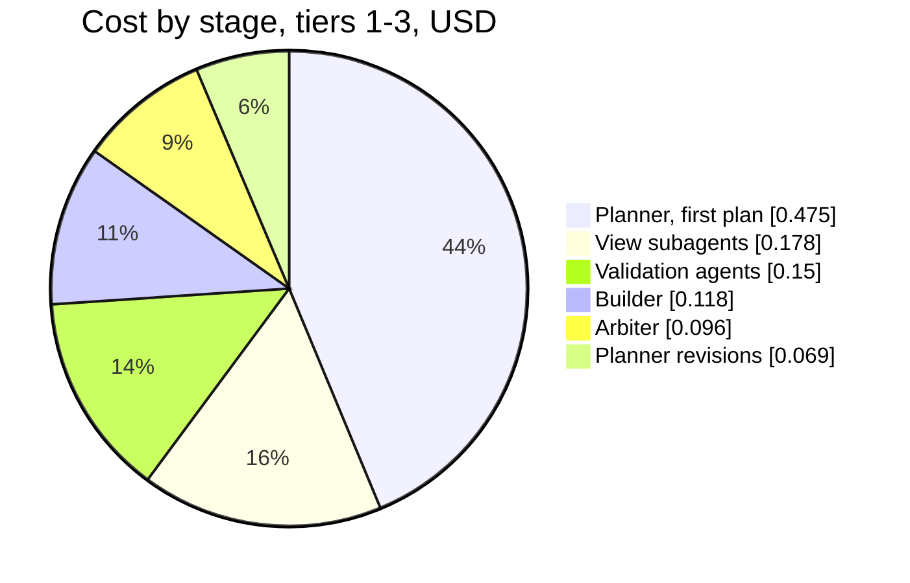

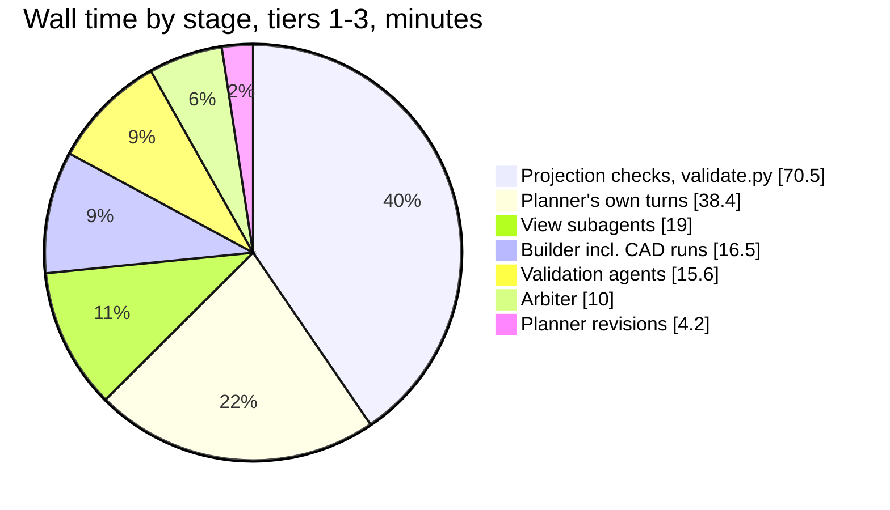

The projection check is 40% of the wall time and costs nothing in tokens. It is the first place to look to make
runs faster.

### 10.3 Tier 4 (scans)

Scans are the hard part, and they are not at the level of tiers 1–3. The best IoU of each case, by date:

| Case | What it is | 2026-10-21, before the views route | After `8e0fbbd` (views route) | Hand build from the drawing's numbers |
|---|---|---|---|---|
| 1 | sheet metal with a flat pattern | 0.61 | parts route, unchanged | — |
| 2 | turned part | 0.91 | 0.97 (first build) | — |
| 3 | bracket of four 5 mm plates | 0.15 (built as a flat plate) | 0.69 (first build); a prototype scored 0.68 / 0.63 / 0.34 over three runs | 0.944 |
| 4 | turned part with holes | 0.28 | not re-scored | — |
| 5 | machined channel housing in Z layers | 0.105 | 0.37 | 0.865 |
| 6 | — | 0.107 | not re-scored | — |
| 7 | sheet metal with a flat pattern | 0.175 (wrong blank snapped) | not re-scored | — |
| 8 | — | no model (API error during planning) | not re-scored (retries added since) | — |

The hand builds show that the operations available are enough (plates for case 3, layers for case 5). The gap is
in reading the scan: thickness misread, a wall missed, a shape misunderstood before any recipe applies.

---

## 11. Traces, run folders and results

```
runs/<tier>-<case>-<time>/            (UI jobs: runs/ui-<job>-<time>/)
├── trace.jsonl          every event: run_start, split, agent_start, llm, tool, rejected,
│                        agent_end, cross_check, projections, blank_snapped, run_end
├── views/               split views (PDF + PNG) and the boxed overview
├── summaries/           one JSON per view analysis: <view>.<agent>.json
├── cross_check.json     conflict items + the arbiter's rulings
├── plan.json            the planner's full answer (overview, tree, uncertainties)
├── feature_tree.json    the tree, with each feature's state
├── build/               attempt_NN.py / .step / .json for every build attempt
├── build_report.json    the builder's per-feature report
├── model.py, model.step the kept model
├── validation/round_N/  that round's model, projections, images, validation.json, one report per view
├── parts/               scans only: views_found.json, views.json, matches.json, dims.json, axes.json, trace.jsonl
├── viewer.html          three.js viewer, model and reference
└── result.json          status, validated, drawn_covered, high_issues_left, kept_round, rounds,
                         build_attempts, seconds, cost_usd, calls_without_cost, models
```

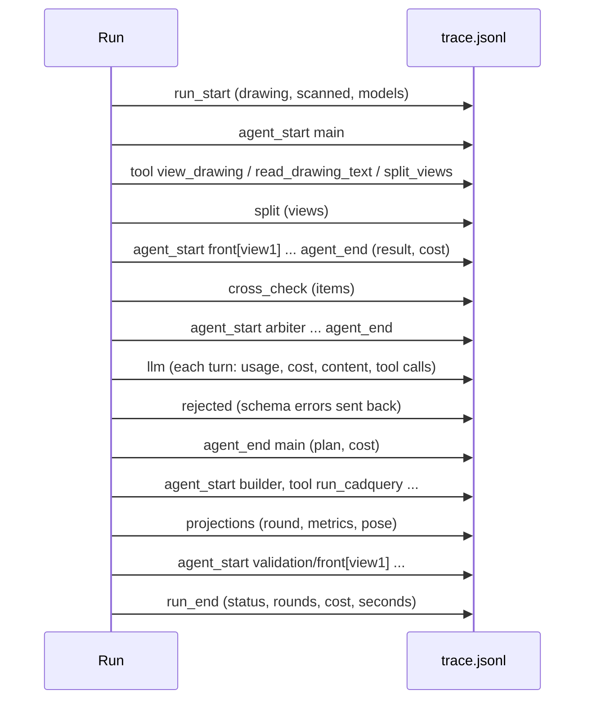

A success or a failure can be inspected from the trace alone: what each agent saw, said, called and cost, and
why each issue was kept, screened or escalated. The UI's step list is built from the same file.

---

## 12. Cost and time controls

| Control | Value | Where |
|---|---|---|
| Run budget, vector | $0.50 | `agents/main.md` `max_cost_usd` |
| Run budget, scan | $3.00 + the vision step | `SCAN_MAX_COST_USD` |
| At budget | the agent must answer now; no new view analysis; no new correction round | `run.over_budget` |
| Correction rounds | 2 | `MAX_CORRECTIONS` |
| Repair turns for a rejected answer | 2 | `REPAIR_TURNS` |
| CAD script timeout | 120 s | `CAD_TIMEOUT_S` |
| Projection check timeout | 600 s | `VALIDATE_TIMEOUT_S` |
| Parallel jobs | 3 | `solve.py --parallel` |

Observed on tiers 1–3: $0.023–$0.116 per part, 2.4–25 minutes. On scans, one Haiku run of tier 4/01 cost $0.077 in
504 s (commit `ebffedc`). A scan can spend up to $3 plus its vision step.

---

## 13. Known limits

- **Trust on scans.** The scan projection check is not informative. A correct hand-built part (case 3, IoU 0.944)
  scores 8–16% drawn-covered, about as low as a wrong one, and the free camera search can pick the wrong camera.
  On scans, the envelope gate is the only measured check today. Branch `scan-improvements` adds a `trust` flag
  ("do_not_use" / "check") to the result and the UI for that reason.
- **Revisions keep feature ids.** A plan built on the wrong strategy (a block instead of plates) cannot be turned
  into another strategy by a revision.
- **Scan reading errors**: thickness read as 6 or 3.4 instead of 5, a back wall missed, a housing taken for three
  arms. The scan's dimension transcription is one model call per view, with no cross-check yet.
- **Coverage is not a trust score on its own** (§10.2). The harness should report "high issues left" and
  "measured views" first.
- **No sandbox.** Model-written scripts run on the host in a child process, with a timeout but no isolation from
  the file system.
